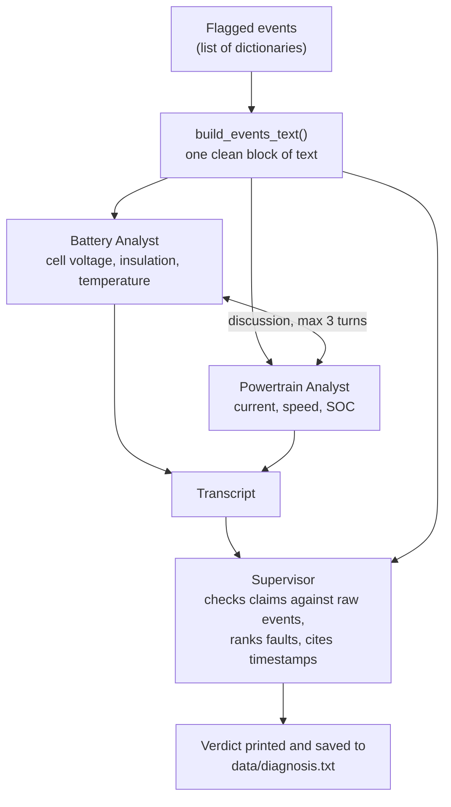

<div align="center">

# EV Fault Diagnosis Agents

**A multi-agent prototype that turns flagged EV telematics events into a ranked, evidence-checked list of likely faults.**


[Overview](#overview) · [How it works](#how-it-works) · [Getting started](#getting-started) · [Design decisions](#design-decisions) · [Limitations](#limitations)

</div>

---

> **Status: learning prototype.** It runs on small, hand-written, synthetic data and has **not** been evaluated against real vehicle faults. See [Limitations](#limitations).

## Overview

Reading raw telematics to find out what is wrong with a vehicle is slow and manual. This project explores a split that is common in practice:

1. **Plain code finds and formats the events.** Anomaly detection is deterministic and testable, so it should not be left to a language model.
2. **Agents interpret the events.** They correlate signals, explain what might be happening, and rank likely causes.

Two specialist agents (battery and powertrain) discuss the events, and a supervisor agent checks their claims against the raw data.

At the moment, step 1 is represented by a hand-written list of flagged events. Replacing it with a real detector would be a natural next step.

## How it works



### Agents

| Agent | Scope | Rules |
|---|---|---|
| **Battery Analyst** | Cell voltage, insulation, temperature | Ignores all other signals; cites a timestamp for every event it mentions |
| **Powertrain Analyst** | Pack current, vehicle speed, SOC | Ignores all other signals; cites a timestamp for every event it mentions |
| **Supervisor** | Reads the discussion and the raw events | Must cite supporting timestamps, name which analyst raised each fault, and answer "not enough evidence" when the data does not support a conclusion |

### Input format

Each event is a dictionary. `severity` and `note` are optional and handled safely when missing.

```python
{
    "timestamp_s": 1500,
    "signal": "cell_v_min",
    "value": 3.97,
    "severity": "high",
    "note": "cell 37 sagging under load",
}
```

## Getting started

### Prerequisites

- Python 3.10 or newer
- A Google AI Studio API key for the Gemini API

### Installation

```bash
git clone <your-repo-url>
cd ev-fault-diagnosis-agents

python -m venv .venv
```

Activate the virtual environment:

| Shell | Command |
|---|---|
| Windows (Command Prompt) | `.venv\Scripts\activate.bat` |
| Windows (PowerShell) | `.venv\Scripts\Activate.ps1` |
| macOS / Linux | `source .venv/bin/activate` |

Install the dependency:

```bash
pip install "autogen[gemini]"
```

### Configuration

The API key is read from the `GEMINI_API_KEY` environment variable. Never put it in the code or commit it.

| Shell | Command |
|---|---|
| Windows (Command Prompt) | `set GEMINI_API_KEY=your-key-here` |
| Windows (PowerShell) | `$env:GEMINI_API_KEY="your-key-here"` |
| macOS / Linux | `export GEMINI_API_KEY="your-key-here"` |

The variable lasts only for the current terminal session.

### Run

```bash
python ev_fault_diagnosis.py
```

The supervisor's verdict is printed to the terminal. The verdict and the full agent discussion are also written to `data/diagnosis.txt`, which is created on the first run.

## Project structure

```
ev-fault-diagnosis-agents/
├── ev_fault_diagnosis.py   # agents, event formatting, and saving
├── README.md
└── LICENSE
```

## Design decisions

- **Plain code formats the events; agents do not parse raw data.** Language models are unreliable at spotting anomalies in raw numbers, so agents receive a short, clean list of flagged events.
- **Separate lanes for the analysts.** Each analyst is told which signals to ignore, so the discussion has distinct perspectives instead of two agents repeating each other.
- **The supervisor is grounded in the data.** It receives the raw events as well as the discussion, and is instructed to verify claims, cite timestamps, and refuse to guess.
- **Defensive handling of missing fields.** Events without a severity or note do not crash the pipeline.
- **The API key stays out of the code.** It is read from an environment variable.

## Limitations

- **Synthetic, hand-written data.** The events are illustrative. Nothing here has been validated on real vehicle data.
- **No evaluation yet.** There is no measurement of how many true faults are found or how many false alarms are raised, so no accuracy claim is made.
- **Language-model output is not deterministic.** Different runs can produce different diagnoses.
- **No fault-code mapping.** Diagnostic trouble codes (DTCs) vary by manufacturer. The agents do not use an authoritative DTC list, and any code they mention should be treated as unverified.
- **Not for safety decisions.** This is a learning project and must not be used to make decisions about real vehicles.

## Built with

- [AutoGen](https://github.com/ag2ai/ag2) (`ConversableAgent`) for the agents
- Google Gemini via the Gemini API

## License

Released under the [MIT Ligit initcense](LICENSE).
MIT License

Copyright (c) 2026 Muiruri Alex

Permission is hereby granted, free of charge, to any person obtaining a copy
of this software and associated documentation files (the "Software"), to deal
in the Software without restriction, including without limitation the rights
to use, copy, modify, merge, publish, distribute, sublicense, and/or sell
copies of the Software, and to permit persons to whom the Software is
furnished to do so, subject to the following conditions:

The above copyright notice and this permission notice shall be included in all
copies or substantial portions of the Software.

THE SOFTWARE IS PROVIDED "AS IS", WITHOUT WARRANTY OF ANY KIND, EXPRESS OR
IMPLIED, INCLUDING BUT NOT LIMITED TO THE WARRANTIES OF MERCHANTABILITY,
FITNESS FOR A PARTICULAR PURPOSE AND NONINFRINGEMENT. IN NO EVENT SHALL THE
AUTHORS OR COPYRIGHT HOLDERS BE LIABLE FOR ANY CLAIM, DAMAGES OR OTHER
LIABILITY, WHETHER IN AN ACTION OF CONTRACT, TORT OR OTHERWISE, ARISING FROM,
OUT OF OR IN CONNECTION WITH THE SOFTWARE OR THE USE OR OTHER DEALINGS IN THE
SOFTWARE.


## Author

**Muiruri Alex** · [LinkedIn](www.linkedin.com/in/alex-muiruri-410457215) · [GitHub](https://github.com/your-laywright)